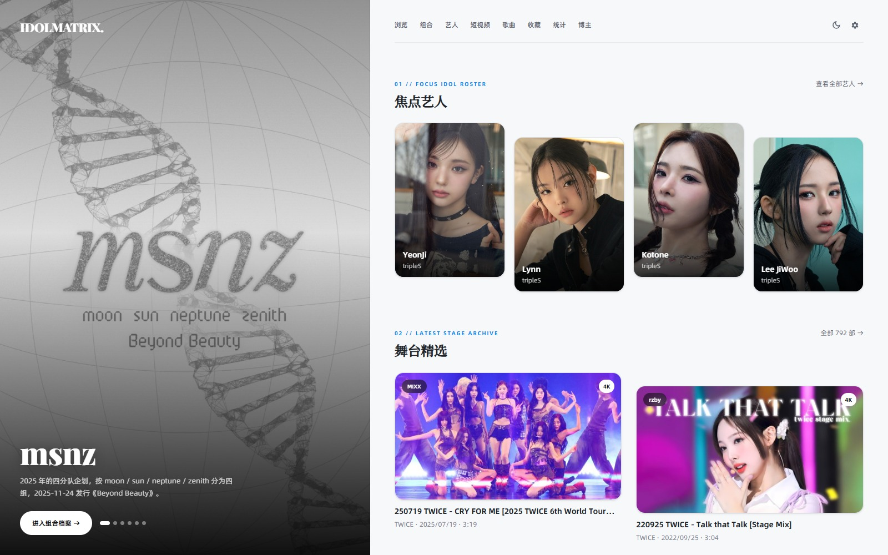
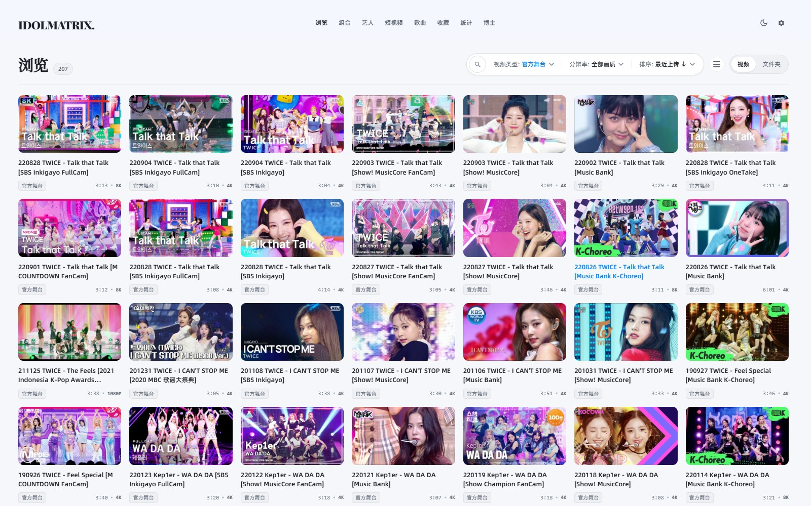
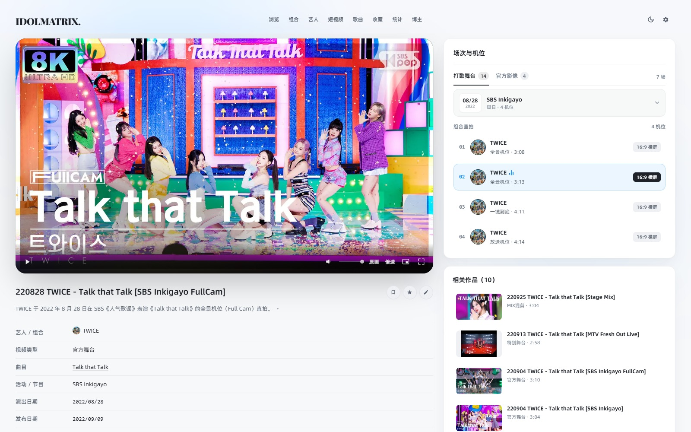
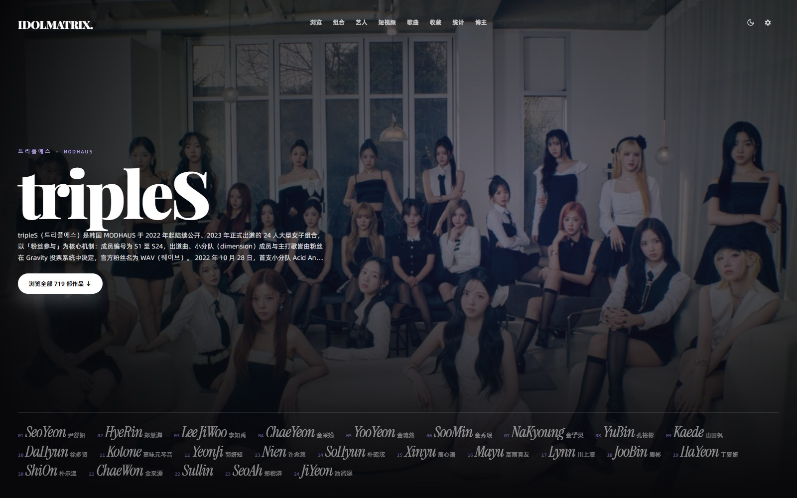
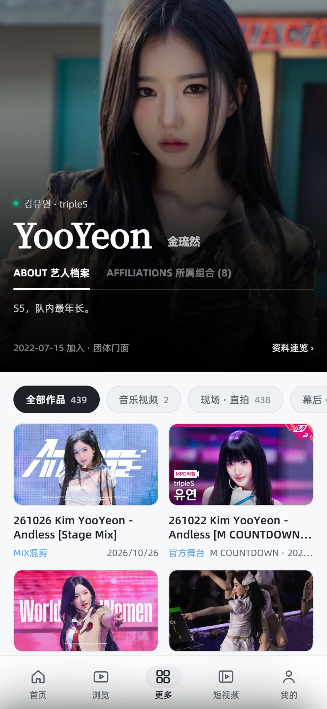
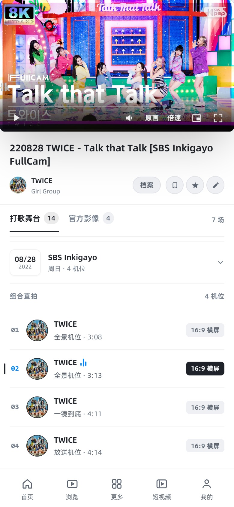

# idolMatrix · K-pop 影像资料库

> 4.0 的重心是**视觉与媒体展示逻辑**（场次 × 机位）；后续方向是**入库交给外部 agent**、
> **走向在线化**（外接哔哩哔哩 / YouTube，内容社区共建）。
>
> ⚠️ 4.0.0 仍有若干待完善项（场次归并误差、国产内核播放降级、无多用户体系等），见 [4.5](#45-400-已知不足待完善)。

---

## 一、开发目的

**起点是一个很具体的麻烦**：我的 K-pop 视频越攒越多（舞台、直拍、MV、综艺、短视频、混剪…），散在硬盘里。
文件名是平台下载后的原始自由文本，夹着画质标签、日期、缩写和韩文，既搜不到也看不清，
想找「某组合某首歌的某场舞台」只能靠记忆翻目录。

**通用媒体服务器（Jellyfin / Emby / Plex）解决不了这个问题**：

K-pop 影像的核心维度是**人**——哪个组合、哪几个成员、成员与组合关系，哪首歌、哪场活动、什么类型。

所以这个项目的目标定得很明确：

| # | 目标 | 具体做法 |
|---|---|---|
| 1 | **以「组合 / 艺人 / 歌曲 / 活动」为第一维度**组织视频，而不是「电影 / 剧集」 | 独立的实体模型：组合、艺人、成员关系、专辑、歌曲、影像，多态发行主体 |
| 2 | **入库半自动化**：AI 读文件名 + 封面 + 描述给候选，人点确认 | 入库向导 + 本地关系优先的匹配级联，一次入库永久沉淀 |
| 3 | **一个入口看完**：浏览、筛选、搜索、直接在浏览器里播 | 按类型/分辨率/主体多维浏览，能直放就直放，放不了自动转码 |
| 4 | 顺带长成**一份可查阅的偶像资料库** | 组合/艺人工作台、关联视图、专辑曲目、照片墙、年度统计、数据体检 |

---

## 二、主要功能

### 2.1 影像入库：AI 识别 + 人工确认

「设置 · 待整理」列出 `incoming/` 里所有待处理的素材，每一行都带探测到的分辨率与文件大小。
右侧「AI 填写」让模型读文件名 + 封面 + 描述，吐出结构化元数据，再逐项确认入库：

- 主体（组合 / 艺人）、活动名、日期、曲目、专辑、视频类型、来源；
- **匹配级联**：库内已有关系优先 → 全站模糊匹配 → 都不中才采用 AI 建议，
  并明确标注「这是 AI 编的新实体，入库时才建」；
- 识别结果全部可在入库前手改（曲目多选、专辑增删、主体换人、类型多选）；
- 中文简介按固定句式生成、可手改，提示词在设置页可自定义；
- 入库动作只由「人点确认」触发——AI 永远只出候选，不写库。

> 这套项目内入库只是**过渡形态**。后续计划把入库管理整体交给外部 agent（见 4.2），
> 项目本身只负责存、看、查。

### 2.2 浏览与筛选

- 视频类型多维筛选：官方 MV / 官方舞台 / 粉丝直拍 / 特别舞台 / 合作舞台 / 翻唱 / MIX 混剪 / 预告 /
  非表演视频 / 短视频 / 其他，可多选（下图＝只看官方舞台）；
- 分辨率按**短边**分 9 档（360p ~ 8K），与转码档位分开，互不混淆；
- 组合 / 艺人 / 歌曲 / 博主 四条独立浏览线，均支持搜索、排序、分页跳页；
- 网格密度三档（紧凑 / 标准 / 宽松），移动端显式列数控制（2 / 2 / 1），桌面端自适应填充。

### 2.3 播放与转码

播放器基于浏览器原生 `<video>` 与 hls.js：

- **能直放就直放**：浏览器解得了的容器/编码（含 4K、MKV、AV1 / VP9）直接吃原文件，画质无损；
- **放不了才转码**：服务端按档位转 H.264 + AAC，**NAS 核显硬件加速（VAAPI / QSV）**，
  硬件不可用时自动回退软件编码；
- **设备解码优先**：先问浏览器能不能解，只在这台设备真的解不了时才动用服务端算力；
- 转码分片未就绪时返回 `503 + Retry-After`，播放器自动续播，不会因为缺一片就报错退出；
- 转码窗口支持任意 seek：窗内原地跳，窗外重建会话；续播位置永久记住；
- 全屏 / 画中画针对老 WebKit、iOS 原生全屏、国产内核的空壳实现都做了兜底；
- 键盘快捷键：`空格 / K` 播放暂停、`← / →` ±5 秒、`M` 静音、`F` 全屏。

### 2.4 视频详情：场次 × 机位

同一个舞台往往有十几个机位（全景、一镜到底、成员直拍、放送版…）。
详情页按「**场次（日期 + 节目）× 机位**」把同一场表演收进一栏，右栏一屏就能换机位：

- 场次选择器带日期块与机位数，切场次即换整组机位；
- 机位行标注画幅（16:9 横屏 / 9:16 竖屏）与时长，正在播的那条高亮；
- 右栏同时给「相关作品」与「相关艺人」，封面按原始比例完整显示，不裁切；
- 「资料速览」抽屉把组合、成员、出道日、所属公司、经历时间线收在一处。

### 2.5 资料库：组合 / 艺人 / 专辑 / 歌曲关系网

- **组合页**：成员头像墙（含加入 / 退出日期）、小分队、所属公司、作品计数、组合简介；
- **艺人页**：所属组合、参与歌曲、作品数、参与成员关系；
- **工作台**：媒体图（横幅 1.82:1 / 头像 1:1，可上传或从历史版本切换）、成员轨迹、专辑曲目、资料来源；
- **关联视图**：一张图看清「组合 ↔ 成员 ↔ 小分队 ↔ 公司 ↔ 专辑」的全部关联与数据缺口，附成员 / 公司变迁时间轴。

### 2.6 统计与年度报告

按年份生成「影像年报」，五个章节依次是：年度人物与组合、24 小时观看与入库波形流、
母带规格分布、365 天入库节奏、艺人热度动量总榜。总量 / 总时长 / 磁盘占用、类型与分辨率构成、
日历热力图、封面九宫格都在同一页。

### 2.7 移动端

全站移动端适配：底部导航、无卡片的整屏详情页、场次机位收成可横滑的行、
竖屏播放页满屏播放。艺人页大字取艺名，小字给本名 / 作品数 / 所属组合。

  
  

### 2.8 数据体检 / 照片墙 / 收藏 / 账号与设置

- **数据体检**：数十项规则扫全库——成员日期矛盾、小分队与成员归属冲突、专辑无曲目、
  影像无主体、重复实体、孤立记录…… 按严重度分三级（阻断 / 影响正确性 / 建议），一键跳转去修；
- **照片墙**：按帖子组织图片（对接外部相册目录或本地上传），帖子大卡片 + 灯箱，大图取磁盘原文件原始字节，零重编码；
- **收藏夹**：视频收藏与图片收藏；**回收站**：删除的实体与影像可恢复；
- **账号**：单用户登录（argon2 密码哈希），也可配置为免鉴权部署；外部工具用 API 令牌（scope 分级、只存哈希、写操作留审计）；
- **设置**：AI 服务商 / 模型 / 密钥、外观（主题 / 强调色 / 刊头优先图，跨端同步）、
  存储目录与扫描、待整理入库、YouTube 下载与订阅、API 令牌、系统信息与硬件加速自检。

### 2.9 技术栈与部署

| 层 | 选型 |
|---|---|
| 后端 | FastAPI + SQLAlchemy 2.0 + Pydantic v2 + SQLite（WAL），Alembic 迁移 |
| 前端 | Vue 3 + Vite + Pinia + TypeScript（Naive UI 只用于少数表单控件，其余组件按站内规范实现） |
| 播放 | 原生 `<video>` + hls.js |
| 媒体处理 | 一律 `subprocess` 调用 FFmpeg / ffprobe（参数、日志、退出码完全可控）；封面人脸居中裁切用 OpenCV 本地推理 |
| AI | 外部大模型 API（可配服务商 / 模型 / 提示词），只做候选、不做写入 |
| 部署 | 单容器：后端直接伺服前端构建产物 + `/api`，一个端口；NAS 侧媒体目录全部卷挂载 |

部署只有四步：`docker load -i` 导入镜像 → 改 `docker-compose.yml` 里的卷路径 →
`docker compose up -d` → 浏览器打开 `http://<NAS-IP>:<端口>`。
数据库与派生文件都挂在宿主目录上，容器删了重建不丢；升级只换镜像标签。

---

## 三、现实痛点：为什么这类库的自动化程度远低于影视类

### 3.1 根因：这个领域**没有可用的元数据站点**

- 电影 / 剧集：TMDB / TVDB / 豆瓣，丢进文件 → 匹配 → 海报、简介、演员、评分全自动；
- 音乐专辑：MusicBrainz / Discogs / TheAudioDB，也有结构化 API 和统一 ID 体系。

但**「某组合在某场音乐节目某天的舞台直拍」这一类影像，没有任何站点提供结构化数据与 API**。

**结论很直接：「刮削」在音乐视频领域不存在，必须自己把信息从文件名、封面帧、简介文本里读出来。**

### 3.2 文件名是自由文本，不是结构化数据

- 同一首歌有**罗马音 / 英文 / 韩文 / 中文 / 别名 / 缩写**至少五到八种写法；
- 同一场活动有三四种命名习惯，日期格式更是千奇百怪；
- 画质标签、频道名、`[]` `()` 里的杂物混在里面。

所以匹配逻辑不能是字符串精确比对，只能是**本地关系优先 + 模糊匹配级联**：
库里已有的组合 / 歌曲 / 活动先在本地命中，命中不了才让 AI 建议新实体，并显式标注「AI 新建」。

### 3.3 因此流程只能是「AI 给候选 + 人工核对」

在这种数据上做全自动入库**必然出错**，而且错得很隐蔽：

- 把合唱里的另一位成员认成主唱；
- 把音乐节目名当成活动名、把专辑名当成歌名；
- 把旧标题里的画质标签当成作品名的一部分。

一次错误会被写进数据库、写进文件路径，事后清理的成本比手动输一遍还高。
现阶段的取舍是：**AI 只做候选，入库动作由人点确认**。
好处是每次核对的结果都沉淀进本地库，下一次同类视频的候选就更准——**用数据自我进化来弥补外部数据源的缺失**。

同一逻辑也体现在提示词上：中文简介**只允许写来源里明确提到的事实**，不许补画质、不许加主观评价、
没写就不许编——因为这段文字最终是要和人核对的内容，宁缺毋滥。

### 3.4 附带的三个成本

- **多语言实体消歧**：韩文 / 英文 / 中文 / 罗马音并存，重名、改名、小分队让「谁是谁」必须人工判；
- **数据会自相矛盾**：库涨到几千条之后，成员日期、归属关系开始互相打脸 → 才需要专门做一个「数据体检」；
- **只有转码和播放这一层是"通用"的**：FFmpeg 是标准件，反而是整条链路里最省心的部分。

---

## 四、4.0 与后续方向

### 4.1 4.0 做了什么：视觉与媒体展示逻辑升级

4.0 不是堆功能，主线是两件事：

**视觉**：详情页去掉卡片框、白底整屏、1px 细线分节；全站筛选条与下拉菜单统一成一套皮肤；
右栏拆成三张独立卡并加物理微光层；深色主题重新对齐；统计页全中文化。

**媒体展示逻辑**：把「一个视频」升级成「**一场表演的多个机位**」——
场次（日期 × 节目）× 机位（全景 / 一镜到底 / 直拍 / 放送版）在右栏一屏切换；
资料速览改成抽屉；相关作品与相关艺人按端限量（PC 10 条 / 手机 5 条），横竖屏封面完整显示不裁切。

播放侧同步做了三件事：设备解码优先、放不了才转码（含整片兼容 MP4）、全屏 / 画中画跨内核兜底。

### 4.2 入库交给外部 agent（方向已定）

项目内的「AI 填写 + 人工确认」只是过渡形态。下一步是把入库管理**完全交给外部 agent**：

- 项目侧只保留数据接口与 API 令牌（scope 分级、写操作带字段级审计），不再维护自己的入库向导与提示词；
- agent 负责读文件名 / 封面 / 描述、查外部资料、判断归属，再通过接口写入；
- 这样入库逻辑与资料库解耦：换模型、换策略、换工作流都不用改项目代码。

### 4.3 在线化与社区共建（规划中）

- 计划支持**在线站点**形态：媒体不再必须是本地文件，改为外接**哔哩哔哩与 YouTube** 的官方播放源；
- 库里只保留元数据与关联关系（谁、哪场、什么类型），实现**去本地化**；
- 代价是内容需要**社区共建**：条目由社区补充与校对，重复与错归属靠数据体检兜住；
- 尚未解决：外链失效与地区限制、版权边界、社区审核成本。

### 4.4 版本

| 版本 | 要点 |
|---|---|
| **4.0.0** | 视觉升级 + 媒体展示逻辑升级：场次 × 机位、资料速览抽屉、全站筛选与下拉统一、统计页中文化、移动端整屏详情 |
| 3.9.8 | 刷抖音模式、统计页河流图与观看时钟、文件夹选择器、待入库与列表筛选优化 |
| 3.9.0 | 章节列表、AI 视频评分、外部频道导入、参与者标注 |

完整变更见 [CHANGELOG.md](CHANGELOG.md)。

### 4.5 4.0.0 已知不足（待完善）

4.0.0 是「视觉与展示逻辑」的版本，功能面仍有明确欠账，先用起来、再逐项补：

- **场次归并有误差**：场次目前按「日期 + 归一化节目名」聚合，同一场写成不同叫法时会被拆成两场，
  还没有合并/拆分场次的手动入口；
- **入库仍在项目内**：4.2 的外部 agent 尚未落地，现在还是「AI 填写 + 人工确认」这套过渡流程；
- **国产内核的播放降级**：vivo / OPPO / 小米自带浏览器会把 `<video>` 劫持给系统播放器，
  这种情况下自定义控制栏、画质切换用不上，只能兜底到原生全屏；
- **转码首帧不是秒开**：切到未转出的位置要等服务端转出第一片，冷门画质等待更明显；
- **筛选细节**：浏览页「类型」多选里的「清空」与「全选」等价（都表示全部），点了没有反应，待修；
- **没有多用户与权限体系**：目前是单用户登录，社区共建（4.3）之前必须先补上账号与审核；
- **在线版尚未开始**：B 站 / YouTube 外链与去本地化还停留在方案阶段。

---

## 附：使用建议

建议先用 AI 把资料库的组合 / 艺人信息填一遍（可以配合音乐平台的 skill），再开始入库视频。
当视频入库达到一定量时，AI 能自己总结出命名与归属规律，这时可以尝试让 AI 自动入库。

本项目全部由 AI 制作，避免不了屎山代码。欢迎在使用过程中交流使用心得、提 issue 优化项目。
